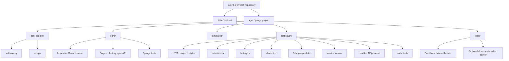
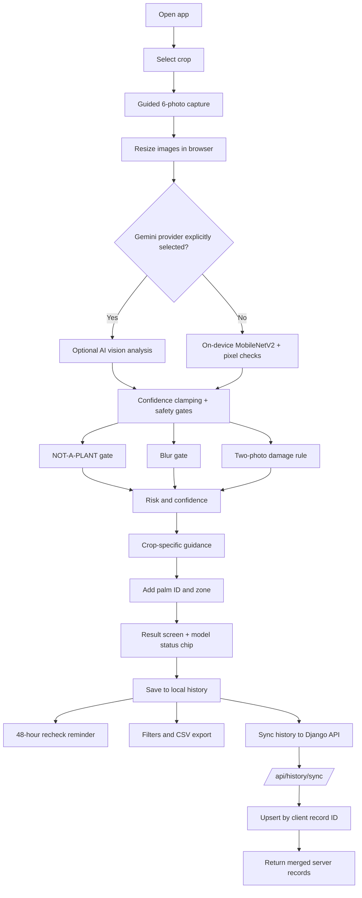

# AGRI-DETECT

AI-powered crop health scanner for Tamil Nadu farmers, built by **Ulavan Tech**. The complete Django project is inside the [`agri/`](agri) folder.

The core app works offline with an on-device TensorFlow.js model, a multilingual crop/problem knowledge base, chat, field history, reminders, CSV export, and optional Django history sync.

---

## Repository structure

```text
AGRI-DETECT/
├─ README.md                         # repository guide, structure and workflow diagrams
└─ agri/                             # complete Django application
   ├─ manage.py                      # Django entry point
   ├─ requirements.txt               # Python dependencies
   ├─ agri_project/                  # project settings and URL root
   │  ├─ settings.py
   │  ├─ urls.py
   │  ├─ asgi.py
   │  └─ wsgi.py
   ├─ core/                          # pages, assets and sync API
   │  ├─ models.py                   # InspectionRecord sync model
   │  ├─ views.py                    # page + /api/history/sync handlers
   │  ├─ urls.py
   │  ├─ tests.py
   │  └─ migrations/
   ├─ templates/                     # Django page templates
   │  ├─ index.html
   │  ├─ detection.html
   │  ├─ history.html
   │  ├─ settings.html
   │  └─ about.html
   ├─ static/agri/                   # browser application and assets
   │  ├─ index.html, detection.html, history.html, settings.html, about.html
   │  ├─ app.js                      # shared app state, notifications, language switch
   │  ├─ detection.js                # capture, model inference, analysis, result
   │  ├─ history.js                  # filters, CSV, follow-ups, sync
   │  ├─ chatbot.js                  # offline multilingual knowledge chatbot
   │  ├─ langs.js, problems*.js      # 8-language UI + crop/problem data
   │  ├─ service-worker.js           # offline PWA cache + reminders
   │  ├─ models/plant-health/        # bundled TF.js health model
   │  ├─ images/, icons/, vendor/    # crop photos, PWA icons, TF.js bundle
   │  ├─ tests/                      # zero-dependency Node test runner
   │  ├─ README.md                   # detailed app documentation
   │  └─ REPORT.md, VALIDATION.md
   └─ tools/                         # optional ML pipeline helpers
      ├─ prepare_feedback_dataset.py
      └─ train_disease_classifier.py
```

---

## Structure diagram



---

## Workflow diagram



---

## Quick start

```bash
cd agri
python -m venv .venv
source .venv/bin/activate          # Windows: .venv\Scripts\activate
pip install -r requirements.txt
python manage.py migrate
python manage.py runserver
```

Open `http://127.0.0.1:8000/`.

Environment variables are optional for local development:

| Variable | Purpose |
|---|---|
| `DJANGO_SECRET_KEY` | Django secret key |
| `DJANGO_DEBUG` | `true` or `false` |
| `DJANGO_ALLOWED_HOSTS` | Comma-separated host list |

---

## Tests

```bash
cd agri
node static/agri/tests/run-tests.js
python manage.py check
python manage.py test
```

Expected: **48 JS assertions passed** and **9 Django tests passed**.

---

## Optional ML tooling

The bundled app already contains the trained health classifier. The scripts in `agri/tools/` are optional helpers for future improvement:

```bash
python tools/prepare_feedback_dataset.py
python tools/train_disease_classifier.py --data dataset/disease --output static/agri/models/disease
```

`train_disease_classifier.py` requires TensorFlow and `tensorflowjs_converter`; it writes a TF.js graph model plus `class_names.json`. Detection uses it only when those files are present.

---

## Main documentation

Detailed app notes are in [`agri/static/agri/README.md`](agri/static/agri/README.md), test notes in [`agri/static/agri/tests/README.md`](agri/static/agri/tests/README.md), field validation notes in [`agri/static/agri/VALIDATION.md`](agri/static/agri/VALIDATION.md), and the project report in [`agri/static/agri/REPORT.md`](agri/static/agri/REPORT.md).
