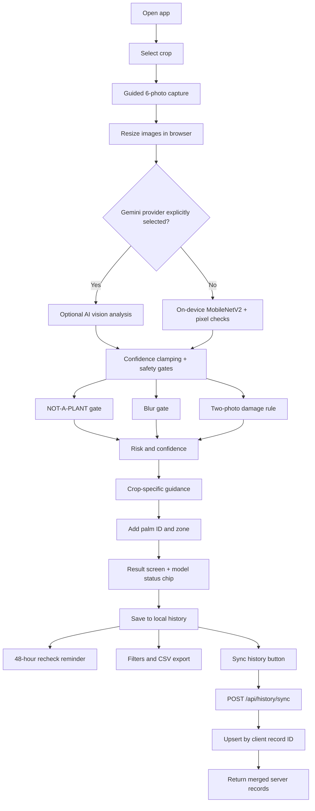

# AGRI-DETECT

AI-powered crop health scanner for Tamil Nadu farmers, built by **Ulavan Tech**. The complete Django project is inside the [`agri/`](agri) folder.

The core app works offline with an on-device TensorFlow.js model, a multilingual crop/problem knowledge base, chat, field history, reminders, CSV export, and optional Django history sync.

| Item | Details |
|---|---|
| Repository | `Njbalamani/AGRI-DETECT` |
| Maintainer | **N J BALA MANIKANTAN** |
| Organization | Ulavan Tech |
| Project folder | [`agri/`](agri) |
| Backend | Django |
| Frontend | Vanilla JavaScript, HTML, CSS, TensorFlow.js |
| Languages | English, Tamil, Hindi, Telugu, Kannada, Malayalam, Bengali, Marathi |
| Offline support | Service worker PWA |
| License | [MIT](LICENSE) |
| Last updated | 22/11/2026 |

---

## Repository structure

```text
AGRI-DETECT/
├─ README.md                         # repository guide, structure and workflow diagrams
├─ LICENSE                           # MIT license in maintainer name
└─ agri/                             # complete Django application
   ├─ manage.py                      # Django command-line entry point
   ├─ requirements.txt               # Python dependencies
   ├─ agri_project/                  # project settings and URL root
   │  ├─ settings.py
   │  ├─ urls.py
   │  ├─ asgi.py
   │  └─ wsgi.py
   ├─ core/                          # pages, assets and sync API
   │  ├─ models.py                   # InspectionRecord sync model
   │  ├─ views.py                    # page + /api/history/sync handlers
   │  ├─ urls.py
   │  ├─ tests.py
   │  └─ migrations/
   ├─ templates/                     # Django page templates
   │  ├─ index.html
   │  ├─ detection.html
   │  ├─ history.html
   │  ├─ settings.html
   │  └─ about.html
   ├─ static/agri/                   # browser application and assets
   │  ├─ index.html, detection.html, history.html, settings.html, about.html
   │  ├─ app.js                      # shared app state, notifications, language switch
   │  ├─ detection.js                # capture, model inference, analysis, result
   │  ├─ history.js                  # filters, CSV, follow-ups, sync
   │  ├─ chatbot.js                  # offline multilingual knowledge chatbot
   │  ├─ langs.js, problems*.js      # 8-language UI + crop/problem data
   │  ├─ service-worker.js           # offline PWA cache + reminders
   │  ├─ models/plant-health/        # bundled TF.js health model
   │  ├─ images/, icons/, vendor/    # crop photos, PWA icons, TF.js bundle
   │  ├─ tests/                      # zero-dependency Node test runner
   │  ├─ README.md                   # detailed app documentation
   │  ├─ REPORT.md                   # project report
   │  ├─ VALIDATION.md               # validation notes
   │  └─ LICENSE                     # app-level MIT license
   └─ tools/                         # optional ML pipeline helpers
      ├─ prepare_feedback_dataset.py
      └─ train_disease_classifier.py
```

---

## Detailed folder responsibilities

| Path | Type | Responsibility |
|---|---|---|
| `README.md` | Documentation | Repository overview, diagrams, commands, tables and license information. |
| `LICENSE` | Legal | MIT license owned by **N J BALA MANIKANTAN**. |
| `agri/manage.py` | Django CLI | Runs migrations, checks, tests and the development server. |
| `agri/requirements.txt` | Dependencies | Declares Django as the Python dependency. |
| `agri/agri_project/settings.py` | Configuration | Security settings, static file routing, host and debug environment variables. |
| `agri/agri_project/urls.py` | Routing | Includes app routes and keeps API routes before the static catch-all. |
| `agri/core/models.py` | Database | Defines `InspectionRecord` for history synchronization. |
| `agri/core/views.py` | Backend logic | Serves pages/static assets and handles `GET/POST /api/history/sync`. |
| `agri/core/urls.py` | Routing | Maps pages and the history sync API. |
| `agri/core/tests.py` | Tests | Django page, asset, template-consistency and sync API tests. |
| `agri/core/migrations/` | Database | Stores the `InspectionRecord` schema migration. |
| `agri/templates/` | Django templates | Server-rendered copies of the five browser pages. |
| `agri/static/agri/` | Frontend | Browser app, assets, localization data, model files and tests. |
| `agri/tools/` | ML tooling | Converts feedback into datasets and trains an optional disease classifier. |

---

## Structure diagram

```mermaid
graph TD
    ROOT[AGRI-DETECT repository] --> README[README.md]
    ROOT --> LICENSE[LICENSE - N J BALA MANIKANTAN]
    ROOT --> APP[agri/ Django project]

    APP --> CONF[agri_project/]
    APP --> CORE[core/]
    APP --> TPL[templates/]
    APP --> STATIC[static/agri/]
    APP --> TOOLS[tools/]
    APP --> CLI[manage.py]
    APP --> REQ[requirements.txt]

    CONF --> SET[settings.py]
    CONF --> URLS[urls.py]
    CONF --> ASGI[asgi.py]
    CONF --> WSGI[wsgi.py]

    CORE --> MODEL[InspectionRecord model]
    CORE --> VIEW[Pages + history sync API]
    CORE --> CURLS[core/urls.py]
    CORE --> TEST[Django tests]
    CORE --> MIG[migrations/]

    TPL --> INDEX[index.html]
    TPL --> DET_HTML[detection.html]
    TPL --> HIS_HTML[history.html]
    TPL --> SET_HTML[settings.html]
    TPL --> ABT_HTML[about.html]

    STATIC --> UI[HTML pages + styles]
    STATIC --> APPJS[app.js]
    STATIC --> DET[detection.js]
    STATIC --> HIS[history.js]
    STATIC --> CHAT[chatbot.js]
    STATIC --> I18N[i18n.js]
    STATIC --> LANG[8-language data]
    STATIC --> SW[service worker]
    STATIC --> ML[bundled TF.js model]
    STATIC --> ASSETS[images, icons, vendor]
    STATIC --> JS_TEST[Node tests]

    TOOLS --> FEEDBACK[Feedback dataset builder]
    TOOLS --> TRAIN[Optional disease classifier trainer]
```



---

## Workflow diagram



---

## Frontend file guide

| File / folder | Purpose |
|---|---|
| `static/agri/index.html` | Crop selection home page. |
| `static/agri/detection.html` | Guided capture, review and result screen. |
| `static/agri/history.html` | Saved inspection records with filters, CSV and sync. |
| `static/agri/settings.html` | AI provider, Gemini key and reminder settings. |
| `static/agri/about.html` | Project information and model description. |
| `static/agri/app.js` | Shared state, language switching, notifications and follow-up checks. |
| `static/agri/detection.js` | Camera flow, image analysis, model inference and result rendering. |
| `static/agri/history.js` | History storage, filters, CSV export, rechecks and sync merge. |
| `static/agri/chatbot.js` | Offline multilingual chatbot and optional Gemini answers. |
| `static/agri/i18n.js` | Language engine that translates `[data-i18n]` elements. |
| `static/agri/langs.js` | UI strings for all eight languages. |
| `static/agri/problems*.js` | Crop/problem knowledge base in each language. |
| `static/agri/service-worker.js` | Offline cache, PWA shell and recheck notifications. |
| `static/agri/manifest.json` | PWA name, icons and display settings. |
| `static/agri/styles.css` | Complete responsive UI styling. |
| `static/agri/tests/run-tests.js` | Zero-dependency Node test runner. |
| `static/agri/models/plant-health/` | Bundled TensorFlow.js health classifier. |
| `static/agri/images/` | Crop photos used by the UI. |
| `static/agri/icons/` | PWA icons. |
| `static/agri/vendor/tf.min.js` | Vendored TensorFlow.js bundle. |

---

## Django project guide

| File | Purpose |
|---|---|
| `agri_project/settings.py` | `SECRET_KEY`, `DEBUG`, `ALLOWED_HOSTS`, security headers and `AGRI_STATIC_ROOT`. |
| `agri_project/urls.py` | Includes `core.urls` and routes assets through the custom static view. |
| `agri_project/asgi.py` | ASGI entry point for async servers. |
| `agri_project/wsgi.py` | WSGI entry point for production servers. |
| `core/apps.py` | Django app configuration. |
| `core/models.py` | `InspectionRecord` model for synced field records. |
| `core/views.py` | Page views, asset serving and history sync API. |
| `core/urls.py` | Page and API URL patterns. |
| `core/tests.py` | Django test suite. |
| `core/migrations/0001_initial.py` | Creates the `InspectionRecord` table. |

---

## Django commands

Run these commands from the `agri/` folder.

| Command | When to use | What it does |
|---|---|---|
| `python manage.py check` | Before every commit | Checks Django project configuration. |
| `python manage.py migrate` | First setup and after pulling model changes | Applies database migrations. |
| `python manage.py makemigrations` | After editing `core/models.py` | Creates a new migration file. |
| `python manage.py showmigrations` | Before/after migrations | Lists migration names and applied status. |
| `python manage.py runserver` | Daily development | Starts the app at `http://127.0.0.1:8000/`. |
| `python manage.py runserver 0.0.0.0:8000` | Phone/LAN testing | Makes the dev server reachable from other devices. |
| `python manage.py test` | Before every commit | Runs all Django tests. |
| `python manage.py test core.tests.AgriHistorySyncTests` | API-only verification | Runs only history sync API tests. |
| `python manage.py createsuperuser` | If admin access is needed | Creates a Django admin user. |
| `python manage.py shell` | Debugging | Opens a Python shell with Django loaded. |
| `python manage.py dbshell` | Database debugging | Opens the configured database shell. |
| `python manage.py collectstatic` | Static collection check | Collects static files if using Django static collection. |

---

## Quick start — Windows PowerShell

```powershell
cd agri
py -m venv .venv
.\.venv\Scripts\Activate.ps1
pip install -r requirements.txt
python manage.py migrate
python manage.py check
python manage.py test
python manage.py runserver
```

If PowerShell blocks activation, use Command Prompt:

```cmd
cd agri
py -m venv .venv
.\.venv\Scripts\activate.bat
pip install -r requirements.txt
python manage.py migrate
python manage.py runserver
```

---

## Quick start — macOS / Linux

```bash
cd agri
python3 -m venv .venv
source .venv/bin/activate
pip install -r requirements.txt
python manage.py migrate
python manage.py check
python manage.py test
python manage.py runserver
```

Open `http://127.0.0.1:8000/`.

For phone testing on the same Wi-Fi network:

```bash
python manage.py runserver 0.0.0.0:8000
```

Then open `http://YOUR-COMPUTER-IP:8000/` on the phone.

---

## Environment variables

| Variable | Example | Default | Purpose |
|---|---|---|---|
| `DJANGO_SECRET_KEY` | `a-long-random-secret` | local development key | Django signing key. Use a strong value in production. |
| `DJANGO_DEBUG` | `false` | `false` | Enables Django debug mode only when set to true. |
| `DJANGO_ALLOWED_HOSTS` | `localhost,127.0.0.1` | `127.0.0.1,localhost,testserver` | Comma-separated allowed host names. |

Windows PowerShell example:

```powershell
$env:DJANGO_SECRET_KEY="replace-with-a-long-random-key"
$env:DJANGO_DEBUG="false"
$env:DJANGO_ALLOWED_HOSTS="localhost,127.0.0.1"
python manage.py runserver
```

macOS / Linux example:

```bash
export DJANGO_SECRET_KEY="replace-with-a-long-random-key"
export DJANGO_DEBUG="false"
export DJANGO_ALLOWED_HOSTS="localhost,127.0.0.1"
python manage.py runserver
```

---

## URL and API map

| URL | Method | Purpose |
|---|---|---|
| `/` | GET | Home page. |
| `/index.html` | GET | Home page alias. |
| `/detection.html` | GET | Detection and result page. |
| `/history.html` | GET | Inspection history page. |
| `/settings.html` | GET | AI settings page. |
| `/about.html` | GET | Project information page. |
| `/api/history/sync` | POST | Uploads local records and returns merged server records. |
| `/api/history/sync?since=0` | GET | Fetches records changed after the given timestamp. |
| `/<asset_path>` | GET | Serves files from `static/agri/`. |

The project uses `APPEND_SLASH = False`, so use `/api/history/sync` without a trailing slash.

---

## Tests

| Test layer | Command | Expected result |
|---|---|---|
| Node unit tests | `node static/agri/tests/run-tests.js` | `48 passed, 0 failed` |
| Django configuration | `python manage.py check` | `System check identified no issues` |
| Django full suite | `python manage.py test` | `9 tests OK` |
| Django sync API only | `python manage.py test core.tests.AgriHistorySyncTests` | 3 sync API tests OK |

---

## Optional ML tooling

The bundled app already contains the trained health classifier. The scripts in `agri/tools/` are optional helpers for future improvement:

```bash
python tools/prepare_feedback_dataset.py
python tools/train_disease_classifier.py --data dataset/disease --output static/agri/models/disease
```

| Script | Input | Output | Requires |
|---|---|---|---|
| `prepare_feedback_dataset.py` | Feedback NDJSON log | `images/<label>/` plus `manifest.csv` | Python standard library |
| `train_disease_classifier.py` | Labeled image class folders | TF.js graph model plus `class_names.json` | TensorFlow and `tensorflowjs_converter` |

Detection uses the optional classifier only when `static/agri/models/disease/tfjs_model/model.json` and `class_names.json` are present.

---

## Main documentation

| Document | Purpose |
|---|---|
| [`agri/static/agri/README.md`](agri/static/agri/README.md) | Detailed app documentation and model notes. |
| [`agri/static/agri/tests/README.md`](agri/static/agri/tests/README.md) | Node test coverage and test hooks. |
| [`agri/static/agri/VALIDATION.md`](agri/static/agri/VALIDATION.md) | Field and browser validation notes. |
| [`agri/static/agri/REPORT.md`](agri/static/agri/REPORT.md) | Project report. |
| [`LICENSE`](LICENSE) | MIT license in **N J BALA MANIKANTAN**'s name. |

---

## License

MIT License. Copyright (c) 2026 **N J BALA MANIKANTAN**. See [`LICENSE`](LICENSE) for full terms.
